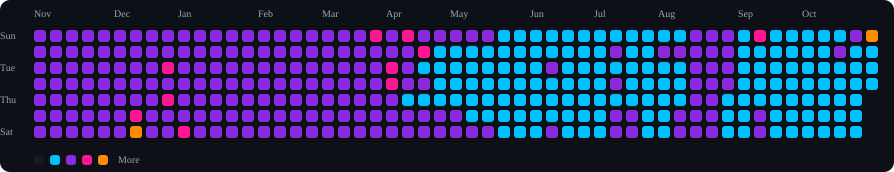
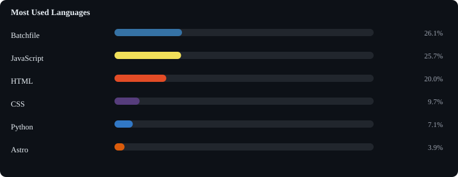

<h1 align="center">Hi 👋, I'm Ritu Raj.</h1>
<h3 align="center">Data Analyst 📊 · Aspiring Data Scientist & Data Engineer 🚀</h3>

  I turn messy data into clear answers, and I'm building the skills to design the pipelines and models behind them.

---

## 👨‍💻 About Me

- 📊 I work with data to find patterns, build dashboards and support decisions
- 🌱 Currently levelling up in **Machine Learning** and **Data Engineering**
- 🎯 Goal: grow from Data Analyst into Data Scientist / Data Engineer
- 🛠️ I build end-to-end projects: raw data → cleaning → analysis → visualisation
- 💬 Ask me about: SQL, Python, Excel, dashboards, data cleaning
- 📫 Reach me through the links at the bottom

## 🛠️ Tech Stack

**Analysis & Visualisation** 

**Programming & Data Science** 

**Learning Now 🌱** 

**Tools** 

## 🗺️ My Learning Roadmap

- [x] Excel & data cleaning
- [x] SQL for analysis
- [x] Python for data (Pandas, NumPy)
- [x] Dashboards (Power BI / Tableau)
- [ ] Statistics & A/B testing
- [ ] Machine Learning with scikit-learn
- [ ] Data pipelines & ETL (Airflow)
- [ ] Cloud & big data (Spark, BigQuery)

<!-- STATS:START -->
## 📊 GitHub Stats

- 📦 **184** public repos
- ⭐ **176** stars earned
- 🍴 **83** forks
- 👥 **45** followers
- 🗓️ On GitHub since **2022**
- 📈 **6,616** contributions in the last year
- 🔨 **5,979** commits · **0** PRs · **0** issues · **0** reviews
- 🔥 **367** day streak (longest **367**)

Updated 27 Oct 2026, 12:16 UTC
<!-- STATS:END -->

<!-- ACTIVITY:START -->
## Activity Heatmap

- Most active day: **Sun**
- Best day: **66 contributions** on 25 Oct 2026
<!-- ACTIVITY:END -->

<!-- LANGS:START -->
## 💻 Top Languages

<!-- LANGS:END -->

<!-- REPOS:START -->
## 🚀 Recently Updated

- **[uptime-pinger](https://github.com/theriturajps/uptime-pinger)** · JavaScript Free uptime monitor using GitHub Actions. Pings endpoints on custom schedules and shows l…
- **[proxy-list](https://github.com/theriturajps/proxy-list)** · ⭐ 13 · Python Automatically updated repository of free public proxies. Hourly refreshed HTTP/HTTPS prox…
- **[MS-Office-2022](https://github.com/theriturajps/MS-Office-2022)** · Batchfile
- **[Cloudflare-Tunnel](https://github.com/theriturajps/Cloudflare-Tunnel)** Access your localhost from anywhere in the world using Cloudflare Tunnel — no port forwar…
- **[private-chat](https://github.com/theriturajps/private-chat)** · ⭐ 1 · HTML
<!-- REPOS:END -->

<!-- FEED:START -->
## ⚡ Recent Activity

- ⭐ Starred [donnemartin/system-design-primer](https://github.com/donnemartin/system-design-primer) · 8 days ago
- ⭐ Starred [morluto/rea](https://github.com/morluto/rea) · 10 days ago
<!-- FEED:END -->

<!-- POSTS:START -->

<!-- POSTS:END -->

## 📫 Let's Connect

<i>Always curious. Always learning. Always querying. 🔍</i>

